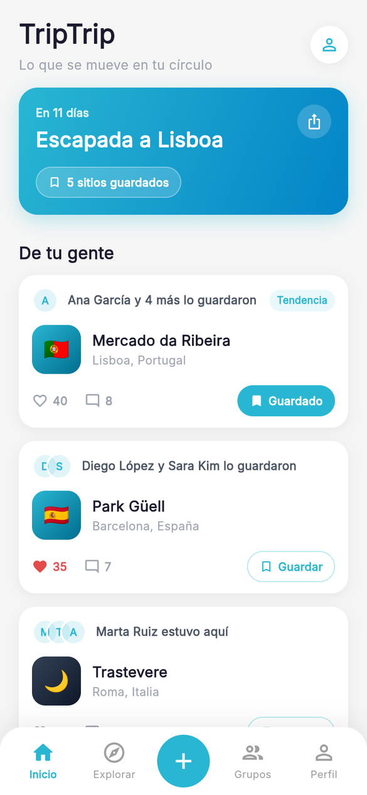
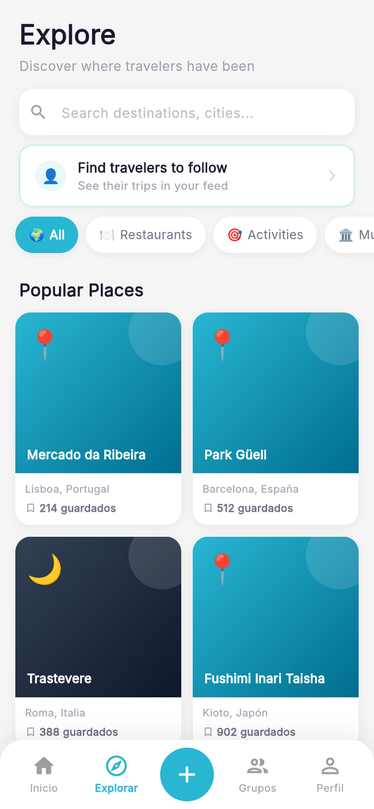
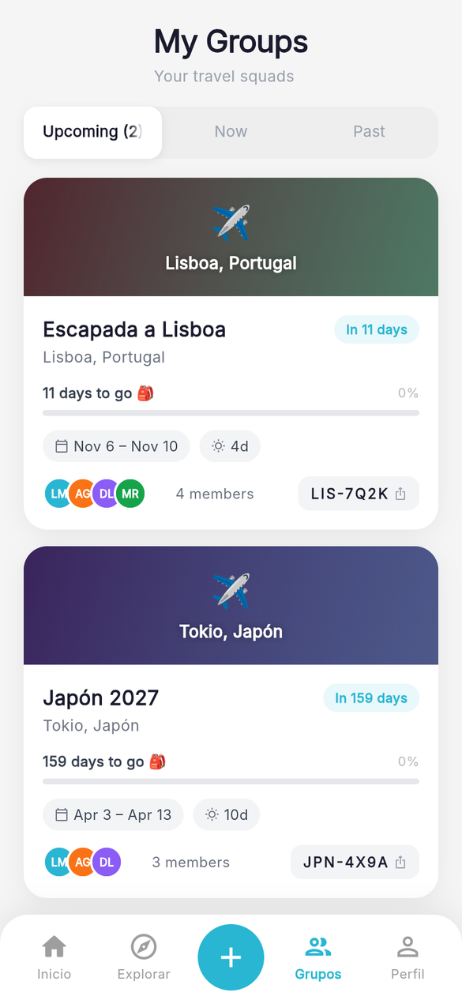
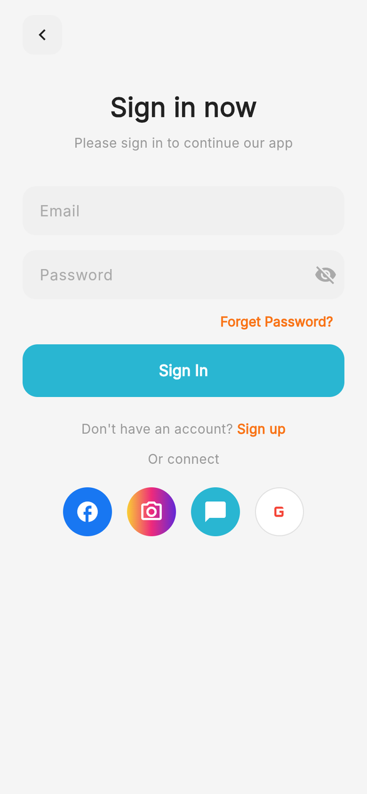
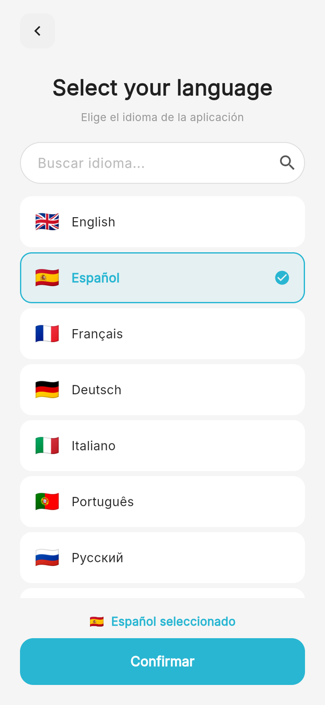
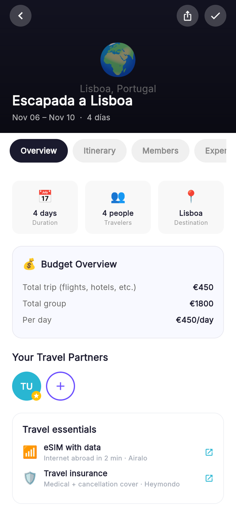
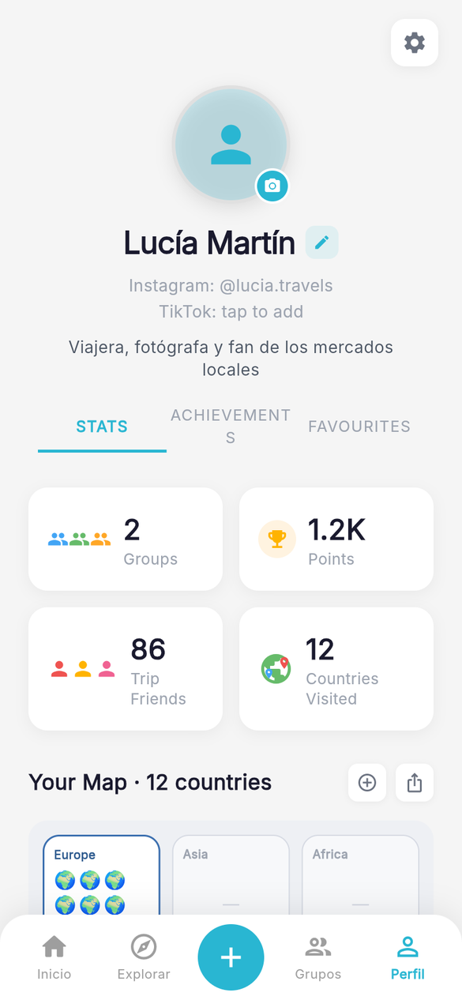
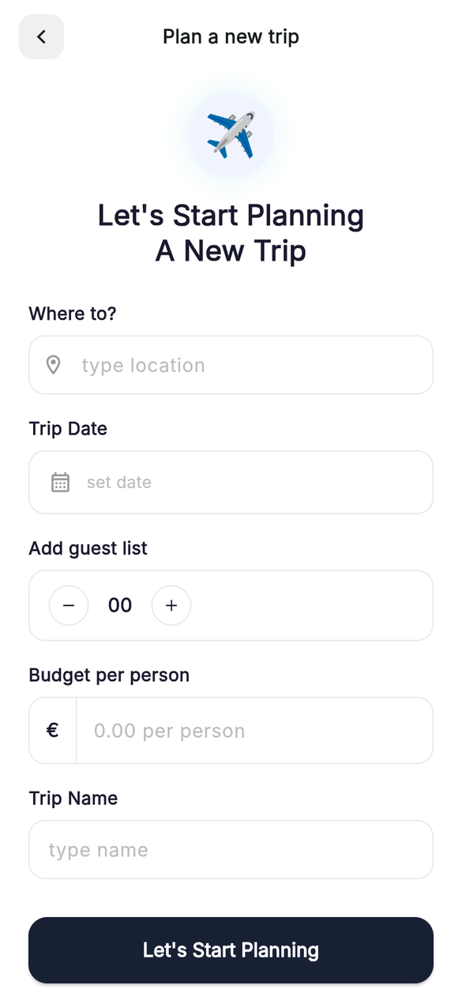

<div align="center">

# ✈️ TripTrip

**Plan trips with your friends, discover places through the people you trust, and keep a living map of everywhere you've been.**

A cross-platform social travel app built with Flutter, Firebase Auth and Supabase.


<br/>

&nbsp;
&nbsp;


</div>

---

## Overview

TripTrip turns trip planning into a social experience. Instead of anonymous reviews, the home feed shows what **your circle** is saving, visiting and publishing. Friends form **trip groups** with a shared invite code, collect places into the trip, split the budget, and build a day-by-day itinerary together. After the trip, a quick recap turns ratings into public visits that feed back into everyone's discovery.

## Features

| | |
|---|---|
| 🏠 **Social feed** | Aggregated activity from people you follow — "Ana and 4 others saved this" — with likes, comments and one-tap save into your next trip. |
| 🧭 **Explore** | Popular places ranked by saves and ratings, category filters (restaurants, activities, museums…), and traveller search. |
| 👥 **Trip groups** | Create a trip, invite friends with a short code (`LIS-7Q2K`), see countdown, members, budget per person and per day. |
| 🗓️ **Itineraries** | Day-by-day plans with timed stops; publish them, rate, comment, favourite and clone other travellers' itineraries. |
| 📍 **Places** | Canonical place catalogue (one record per real-world place), map picker, photos, comments, ratings and visits. |
| 🗺️ **Travel profile** | Stats (groups, points, friends, countries), visited-countries map by continent, achievements and favourite folders. |
| 🏆 **Gamification** | Achievements (first flight, explorer, globetrotter…) and shareable badge / trip cards for Instagram Stories. |
| 🌍 **Localisation** | 12 interface languages selectable at onboarding. |
| 💸 **Monetisation hooks** | Affiliate links (hotels, activities, eSIM, insurance) in the trip kit and AdMob banner/native-feed placements, GDPR-consent aware. |

## Screenshots

<table>
  <tr>
    <td align="center"><br/><sub>Sign in</sub></td>
    <td align="center"><br/><sub>Onboarding · language</sub></td>
    <td align="center"><br/><sub>Home · feed from your circle</sub></td>
    <td align="center"><br/><sub>Explore</sub></td>
  </tr>
  <tr>
    <td align="center"><br/><sub>Trip groups</sub></td>
    <td align="center"><br/><sub>Trip overview & budget</sub></td>
    <td align="center"><br/><sub>Traveller profile</sub></td>
    <td align="center"><br/><sub>Plan a new trip</sub></td>
  </tr>
</table>

<sub>Screenshots show the web build running against fictitious demo data.</sub>

## Architecture

```
┌──────────────────────────── Flutter app (lib/) ────────────────────────────┐
│  screens/   UI — one file per screen (feed, explore, groups, itinerary…)   │
│  widgets/   reusable UI (social actions bar, shareable cards, sheets…)     │
│  services/  data & domain logic — static services wrapping Supabase        │
│             (feed, itineraries, places catalogue, social, achievements,    │
│              visited countries, media, ads, affiliates, analytics)         │
└───────────────┬──────────────────────────────────────────┬─────────────────┘
                │ identity                                  │ data
        ┌───────▼────────┐                       ┌──────────▼───────────┐
        │ Firebase Auth  │  firebase_uid ──────▶ │ Supabase (Postgres)  │
        │ + Analytics    │                       │ tables, views, RPCs  │
        └────────────────┘                       └──────────────────────┘
```

- **Auth** is handled by Firebase (email/password with email verification). Every Supabase row is keyed by `firebase_uid`, so policies never rely on `auth.uid()`.
- **Data** lives in Supabase: `users`, `places`, `user_itineraries`, `itinerary_days`, `trip_groups`, `trip_group_members`, `user_follows`, `place_favorites`, `user_visited_countries`, … plus RPCs such as `feed_for_user`, `list_public_itineraries`, `get_itinerary_detail` and `get_profile_stats`.
- **Startup** initialises Firebase, Supabase and SharedPreferences in parallel and defers AdMob until after the first frame.
- **Maps** use `flutter_map` + OpenStreetMap tiles; location via `geolocator`.

## Project structure

```
lib/
├── main.dart               # entry point, auth gate, onboarding routing
├── firebase_options.dart   # Firebase config read from --dart-define
├── l10n.dart, app_locale.dart
├── screens/                # 30 screens
├── services/               # 17 services
└── widgets/                # shared widgets
supabase/                   # SQL migrations (social feed, ads)
env/                        # dart_defines.example.json (copy → dart_defines.json)
docs/screenshots/
android/ ios/ web/ macos/ linux/ windows/
```

## Getting started

### Prerequisites

- Flutter SDK (Dart ≥ 3.5)
- A Firebase project with Email/Password auth enabled
- A Supabase project with the TripTrip schema

### 1. Configure credentials

No keys are committed to this repository. Copy the template and fill in your own values:

```bash
cp env/dart_defines.example.json env/dart_defines.json
```

`env/dart_defines.json` is git-ignored. It holds `SUPABASE_URL`, `SUPABASE_ANON_KEY` and the `FIREBASE_*` web config values.

### 2. Set up the database

Run the SQL files in `supabase/` from the Supabase SQL editor (`social_feed.sql`, then `ads_setup.sql`).

### 3. Run

```bash
flutter pub get
flutter run --dart-define-from-file=env/dart_defines.json            # mobile
flutter run -d chrome --dart-define-from-file=env/dart_defines.json  # web
```

### 4. Build

```bash
flutter build apk --dart-define-from-file=env/dart_defines.json
flutter build ios --dart-define-from-file=env/dart_defines.json
flutter build web --dart-define-from-file=env/dart_defines.json
```

> **Ads:** the AdMob IDs in `AndroidManifest.xml`, `Info.plist` and `ad_service.dart` are Google's public **test** IDs. Replace them with your own before releasing.

## Tech stack

| Layer | Packages |
|---|---|
| UI | Flutter Material, `cached_network_image`, `flutter_map`, `latlong2` |
| Backend | `supabase_flutter`, `firebase_core`, `firebase_auth`, `firebase_analytics` |
| Device | `geolocator`, `image_picker`, `flutter_image_compress`, `path_provider` |
| Sharing | `share_plus`, `social_share`, `url_launcher` |
| Storage | `shared_preferences` |
| Ads | `google_mobile_ads` |

## Roadmap

- [ ] Bundle the world GeoJSON for the visited-countries map (`assets/geojson/countries.geo.json` is currently a placeholder)
- [ ] Replace the default widget test with real tests for services and the auth gate
- [ ] Release signing configs for Android / iOS
- [ ] Social sign-in (Google, Facebook, Instagram buttons are present in the UI)

## Author

**Víctor Hernández Megía** — [@victorhdez12](https://github.com/victorhdez12)

---

<sub>© Víctor Hernández Megía. All rights reserved.</sub>
